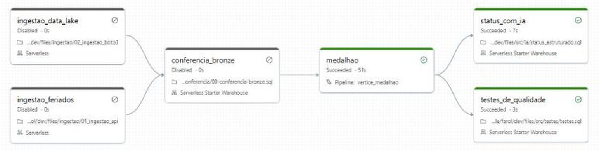
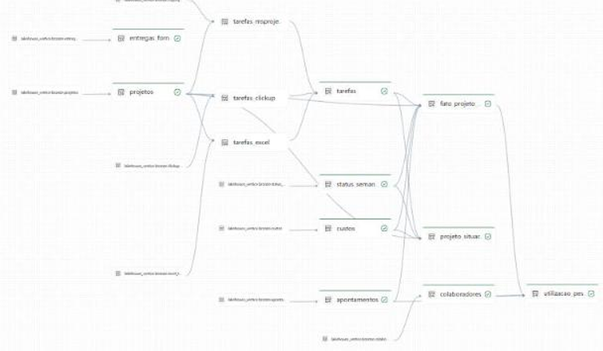
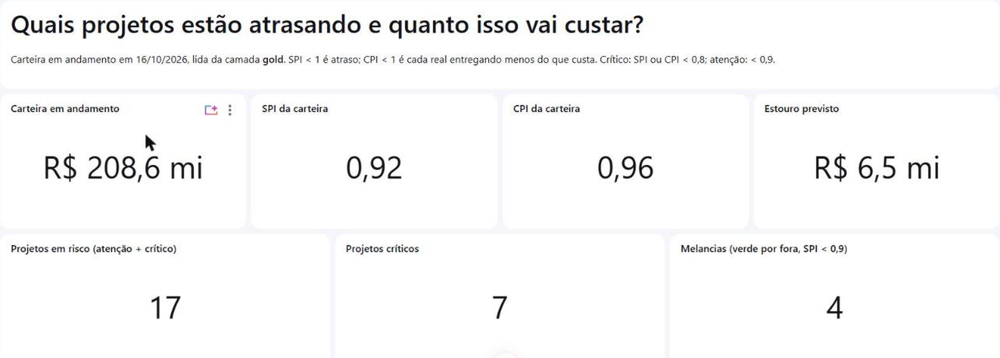
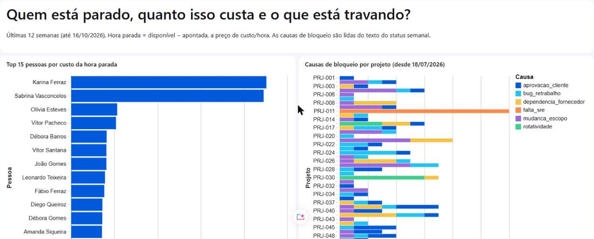
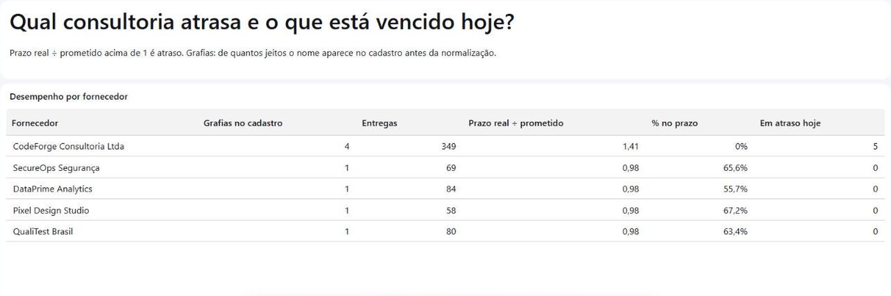
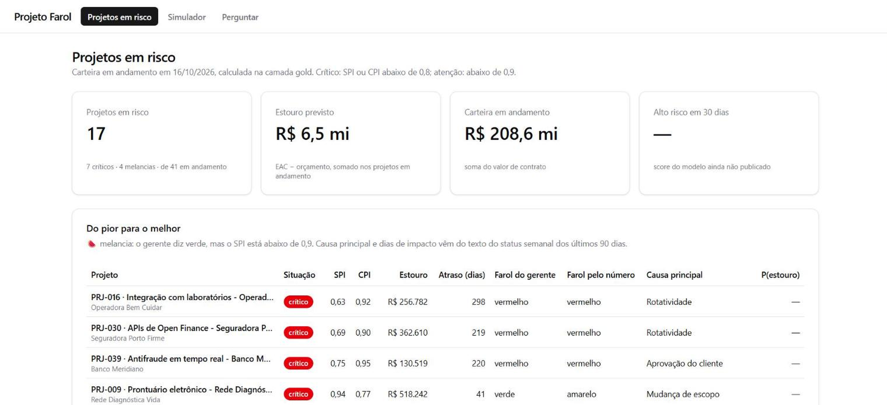
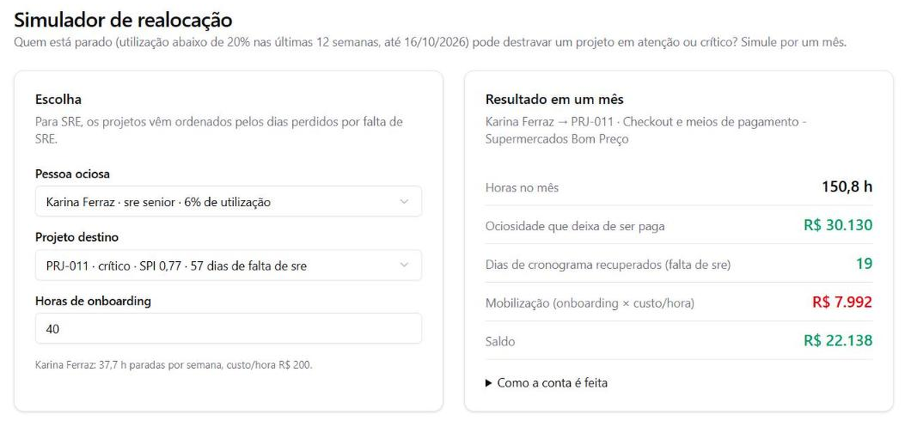
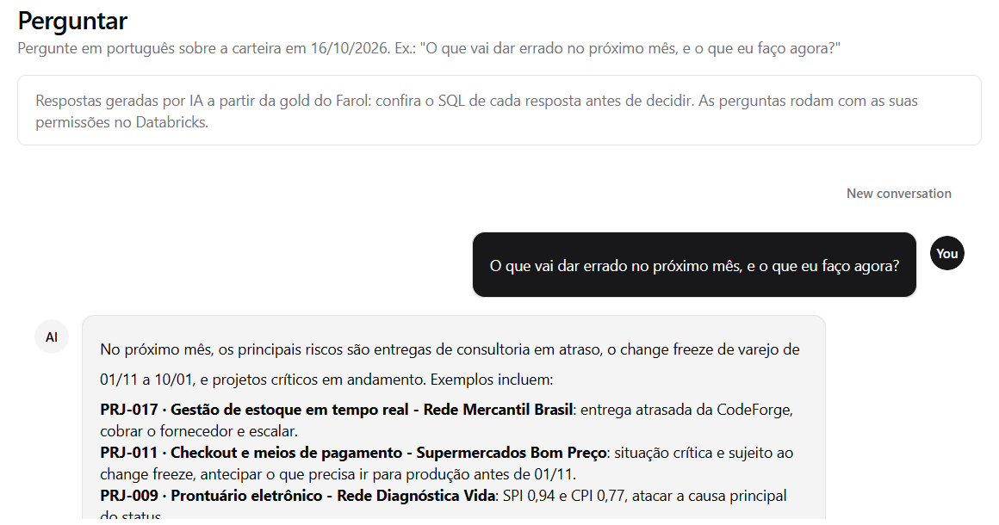

# 🔦 Projeto Farol · Torre de Controle de Projetos

Plataforma de dados no **Databricks** que responde, toda segunda de manhã, quais projetos de uma empresa estão
atrasados, quanto isso custa e o que fazer a respeito. Dos arquivos crus de Excel, ClickUp e MS Project até um
modelo de previsão e um app de decisão, com IA lendo status semanais e contratos.

**Stack:** Databricks Free Edition (serverless) · SQL · Python · Unity Catalog · Lakeflow · AI/BI Dashboards ·
Genie · MLflow · Databricks Apps · Lakebase · Claude Code

> **Sobre este repositório.** É o registro do meu estudo da **Imersão Databricks + Claude Code**, da
> [Jornada de Dados](https://suajornadadedados.com.br), criada por **Luciano Vasconcelos**
> ([material original](https://github.com/lvgalvao/ImersaoControlTower)). O case da Vértice Tecnologia, o dataset
> sintético e o código-base vêm do material da imersão. O que é meu aqui: a organização do repositório, a
> documentação e o registro do que aprendi a cada etapa. Veja os [créditos](NOTICE.md).

---

## 🧭 O problema

A **Vértice Tecnologia** (empresa fictícia, 520 pessoas) tem 60 projetos de clientes de varejo, financeiro, saúde,
logística e indústria. Cada gerente controla o seu do seu jeito: **20 em planilhas Excel, 25 no ClickUp e 15 no
MS Project**. O PMO consolida tudo à mão, toda sexta, e o farol do status semanal está quase todo verde.

A diretoria faz quatro perguntas:

| # | Pergunta | O que a Torre mede |
|---|---|---|
| 1 | **Quais projetos estão atrasados, e de quais clientes?** | SPI, CPI, situação, farol calculado × farol do gerente |
| 2 | **Quanto esse atraso vai me custar?** | EAC, estouro previsto, margem projetada, atraso projetado |
| 3 | **Tenho gente parada enquanto outro projeto pede gente?** | utilização por pessoa e projeto, horas ociosas, causa no status |
| 4 | **O que vai dar errado no próximo mês, e o que eu faço agora?** | probabilidade de estouro em 30 dias, entregas de fornecedor atrasadas, contratos |

Regra de corte: **SPI ou CPI < 0,9 = atenção · < 0,8 = crítico.**

## 🏛️ Arquitetura

```
 FONTES                         LAKEHOUSE · UNITY CATALOG · lakehouse_vertice              CONSUMO
 ──────                         ──────────────────────────────────────────────            ────────────────────
 Excel (20 .xlsx)          ─┐   ┌──────────┐   ┌────────────────┐   ┌───────────────┐     ┌ AI/BI Dashboards
 ClickUp (25 .json)         │   │  BRONZE  │   │     SILVER     │   │     GOLD      │     │
 MS Project (15 .xml)       ├──▶│ como veio│──▶│ as 3 ferramen- │──▶│ KPIs por      │──┬─▶├ Genie
 PMO: status semanal        │   │ read_files│   │ tas num modelo │   │ projeto e     │  │  │   (perguntas do dono)
 RH · timesheet             │   │ lê tudo  │   │ só, testado    │   │ semana        │  │  ├ App da Torre
 Financeiro · compras       │   └──────────┘   │ ai_extract nos │   │ Metric Views  │  │  │   + Lakebase (decisões)
 Contratos em PDF ──────────┘                  │ textos         │   └───────────────┘  │  └ Agente de contratos
                                               └────────────────┘                      │
                                     Modelo de estouro em 30 dias (MLflow, UC) ◀───────┘
```

Os KPIs são definidos **uma vez** (Metric Views no Unity Catalog) e reusados no dashboard, no Genie, no app e no agente.

## 🧠 Decisões de engenharia

| Decisão | Por quê |
|---|---|
| Bronze guarda o dado como veio (`inferColumnTypes => false` em CSV e Excel) | inferir tipo esconderia datas em dois formatos e vírgula decimal: a sujeira sumiria antes de ser vista |
| Dataset determinístico (seed 42) com validador dos padrões | qualquer execução reproduz os mesmos números, e uma mudança no gerador que quebre a história é detectada |
| "Hoje" fixo em `2026-10-16`, nunca `current_date()` | o resultado das análises não muda com o dia em que são executadas |
| Dashboard e Genie definidos como código (JSON) | versionados no Git, sem divergência entre o workspace e o repositório |
| Silver e gold em um pipeline Lakeflow (SQL), com `EXPECT ... ON VIOLATION FAIL UPDATE` | a regra de qualidade derruba a atualização em vez de publicar dado errado |
| 10 testes de negócio em `src/testes/`, com `raise_error`, depois do pipeline | o job falha se a carteira, o custo ou o EV não baterem entre as camadas |
| IA só onde compensa: regra, palavra-chave ou `ai_classify`/`ai_extract` por faixa de data; `MERGE` incremental | IA custa por linha: 163 dos 3.911 status passam por ela, e a segunda execução não reprocessa nada |
| Chaves do data lake como variáveis do bundle, com o valor fora do Git | o repositório é público; nenhuma credencial entra em arquivo versionado |
| Razão não se soma: SPI e CPI da carteira são `SUM(ev)/SUM(pv)` e `SUM(ev)/SUM(ac)` | um projeto pequeno atrasado não pode pesar igual a um grande |
| Verificação com valores esperados (`verificacao-bronze.sql`) | a carga é testada: cada contagem e total de referência retorna `ok` ou `CONFIRA` |
| KPIs definidos uma vez, em Metric Views (próximas etapas) | uma fonte da verdade para dashboard, Genie e app |
| API externa bloqueada no Free Edition: espelho do JSON no GitHub, com o código original documentado | o exercício segue sendo uma chamada HTTP de verdade; ver [decisão 001](docs/decisoes/001-apis-externas-no-free-edition.md) |

## 🗺️ Estado do projeto

| Etapa | Foco | Status |
|---|---|---|
| 1 · Ingestão e análise | catálogo, bronze lendo Excel, JSON e XML, análises SQL, dashboard e Genie sobre a bronze | ✅ disponível |
| 2 · Ingestão automatizada | data lake (S3/boto3), API de feriados, job | ✅ disponível |
| 3 · Modelagem | bundle, silver, gold, testes, IA no texto do status, job completo, dashboard sobre a gold | ✅ disponível |
| 4 · IA e produto | app da Torre, metric view, Genie curado (agente) · modelo de estouro e agente de contratos | 🚧 app, metric view e agente ✅ · modelo e contratos pendentes |

### O que a etapa 1 já responde

Sobre a camada bronze, com as três ferramentas empilhadas à mão em SQL:

| Resultado | Valor |
|---|---|
| Projetos em andamento / em risco / críticos | 41 / 17 / 7 |
| Estouro previsto se nada mudar | R$ 6,47 mi |
| Faróis verdes de gerente com SPI abaixo de 0,9 ("melancias") | 4 projetos (de 32 faróis verdes) |

### O que a etapa 3 entrega

O job **`vertice_farol`** (bundle `farol`) roda toda segunda às 6h (no ambiente de desenvolvimento fica pausado):
ingestão do data lake e dos feriados, conferência da bronze, o pipeline `vertice_medalhao` (silver e gold), e então
os testes de qualidade e a leitura do texto do status por IA, em paralelo.



| Camada | O que tem |
|---|---|
| Silver (7 tabelas) | `projetos`, `tarefas`, `status_semanal`, `custos`, `colaboradores`, `apontamentos`, `entregas_fornecedor`: as 3 ferramentas num modelo só, com a sujeira tratada |
| Gold (4 tabelas) | `fato_projeto_semana` (4.235 linhas), `projeto_situacao_atual` (60), `utilizacao_pessoa_semana` (30.883) e `status_estruturado` (3.911, a causa de cada bloqueio tirada do texto) |
| Testes | 10 testes de negócio; o job falha se algum não passar |



**Dashboard sobre a gold** (AI/BI, definido como código e publicado pelo bundle):



| Página | O que responde | Resultado |
|---|---|---|
| Portfólio | quais projetos atrasam e quanto isso custa | carteira R$ 208,6 mi · SPI 0,92 · CPI 0,96 · estouro previsto R$ 6,5 mi · 17 em risco, 7 críticos, 4 melancias |
| Pessoas | quem está parado e o que trava | as duas SREs seniores no topo do custo da hora parada; o PRJ-011 trava por `falta_sre` há 12 semanas (57 dias de impacto declarado) |
| Fornecedores | qual consultoria atrasa | CodeForge, 4 grafias no cadastro, prazo 1,41× o prometido, 0% no prazo, 5 entregas vencidas |




**O que esta etapa mostrou**

- **Limpeza num lugar só.** Na etapa 1 cada gráfico carregava o `CASE` do Excel, o `replace` da vírgula e o filtro do
  ClickUp. Agora a silver limpa uma vez, e o SQL de cada gráfico cabe em poucas linhas.
- **Teste por total, não por projeto.** O teste de EV compara a carteira em andamento (diferença < 1%). O PRJ-013 diverge
  sozinho (3 tarefas do Excel com percentual acima de 100, que a silver limita a 100); isso ficou documentado no teste,
  sem mexer na regra da silver.
- **IA com custo medido.** Na primeira execução a tarefa de IA levou 118 s (163 textos); na segunda, 7 s, porque o
  `MERGE` só insere o que ainda não está na tabela.
- **A causa do atraso estava escrita.** O texto do status do PRJ-011 pedia SRE toda sexta, e o timesheet mostrava duas
  SREs paradas em outro projeto. Os dois fatos estavam no dado, em sistemas diferentes; agora estão na mesma tabela.
- **Rede do Free Edition varia entre workspaces.** Registrado na [decisão 001](docs/decisoes/001-apis-externas-no-free-edition.md).

Para reproduzir esta etapa: [`docs/etapa-3-como-reproduzir.md`](docs/etapa-3-como-reproduzir.md) e os prompts em
[`llm/`](llm/README.md).

### O que a etapa 4 entrega (até agora)

**O app "Projeto Farol"** (Databricks App, AppKit, React + TypeScript), com o login do workspace. É o primeiro ponto de
contato que não exige SQL Editor: o dono abre uma URL.



| Tela | O que mostra |
|---|---|
| Projetos em risco | 17 de 41 em risco, 7 críticos, 4 melancias, R$ 6,5 mi de estouro; a tabela traz a causa principal lida do status e o farol do gerente ao lado do farol pelo número |
| Simulador | mover a SRE parada COL0017 (6% de utilização) para o PRJ-011: 150,8 h no mês, R$ 30,1 mil de ociosidade evitada, 19 dias de cronograma recuperados, R$ 8,0 mil de onboarding, **saldo de R$ 22,1 mil** no mês, com a conta explicada na tela |
| Perguntar | o agente (Genie "Farol · Diretoria") respondendo em português, com as permissões de quem está logado |




**A metric view `gold.mv_projetos`** guarda a fórmula de cada KPI num lugar só (SPI, CPI, estouro, margem, melancias),
recalculada no grão que a pergunta pedir: SPI 0,92 · CPI 0,96 · estouro R$ 6,47 mi · 7 críticos · 4 melancias.

**O agente "Farol · Diretoria"** (Genie como código, recurso do bundle) lê a gold, a metric view e as entregas de
fornecedor, com instruções de negócio versionadas. Benchmark de 20 perguntas com SQL de referência: **18/20** na
primeira rodada. As duas falhas eram da referência (filtrava pelo rótulo do projeto, e não pelo código), já corrigida.

**O que esta etapa mostrou**

- **O app é um usuário.** Ele roda como service principal e nasce sem acesso: sem `GRANT` na gold e na silver, o build
  falha. A governança do Unity Catalog vale para a aplicação, não só para pessoas.
- **Escopos de OAuth mudam.** O escopo `dashboards.genie` está obsoleto; o atual é `genie`. Trocar o escopo não basta:
  quem já tinha entrado no app precisa autorizar de novo (sessão nova).
- **O warehouse devolve tudo como texto.** A coluna booleana `melancia` chegava como `"false"`, e o app marcava 🍉 em
  todas as linhas. Converter explicitamente resolveu.
- **Benchmark também tem bug.** Antes de mexer na instrução do Genie, vale conferir se a resposta de referência está certa.

## 📁 Estrutura

```
ingestao/      catálogo, carga dos dados no volume e tabelas bronze, com verificação
analises/      análises SQL exploratórias sobre a bronze, até o custo do atraso
dashboards/    dashboards AI/BI gerados como código (JSON): sobre a bronze e sobre a gold
genie/         Genie como código: o da bronze (sem curadoria) e o "Farol · Diretoria", com benchmark
data/          gerador do dataset sintético (seed fixa) e validador dos padrões
tools/         utilitários: rodar .sql no warehouse, publicar e testar Genie
resources/     recursos do bundle: job vertice_farol, pipeline vertice_medalhao, dashboard e Genie da gold
farol-torre/   o app da Torre (Databricks App, AppKit), com bundle próprio
src/           SQL do job: conferência da bronze, silver, gold, testes, IA no status e a metric view
llm/           prompts do Claude Code usados nas etapas 3 e 4
docs/          PRD, decisões de engenharia, passo a passo da etapa 3 e contexto da etapa 4
databricks.yml o bundle (variáveis, ambiente dev)
```

## 🚀 Como executar

Sem instalar nada:

1. Crie a conta gratuita: [databricks.com/learn/free-edition](https://www.databricks.com/learn/free-edition).
2. No Databricks: **Workspace → Create → Git folder** → `https://github.com/RamonRibeiroF/projeto-farol`.
3. Abra `ingestao/01-carregar-dados` e clique em **Run all**. O catálogo é criado e os dados são gerados direto no volume.
4. Abra `ingestao/02-bronze.sql` no **SQL Editor** e rode tudo.
5. Rode as análises em ordem (`analises/`) e, por fim, `ingestao/verificacao-bronze.sql`: todas as linhas devem
   retornar `ok`.

Pelo terminal (com a [CLI do Databricks](https://docs.databricks.com/aws/en/dev-tools/cli/install) ≥ 0.250):

```bash
databricks auth login --profile SEU-PERFIL
python3 tools/run_sql.py ingestao/00-setup-catalogo.sql --profile SEU-PERFIL
python3 tools/run_sql.py ingestao/02-bronze.sql --profile SEU-PERFIL
python3 tools/run_sql.py ingestao/verificacao-bronze.sql --profile SEU-PERFIL
```

## 🗄️ O dataset

Gerado por [`data/gerar_dataset.py`](data/gerar_dataset.py): só biblioteca padrão do Python, **seed fixa 42**, cerca
de 7 MB, em menos de 1 segundo. O "hoje" do dataset é **16/10/2026**.

```bash
python3 data/gerar_dataset.py --saida ./dados --seed 42
python3 data/validar_padroes.py --dados ./dados      # junta as 3 ferramentas e confere os 5 padrões
```

| Sistema | O que vem | Linhas |
|---|---|---:|
| PMO | `projetos` · `status_semanal` (texto livre e farol) | 60 · 3.911 |
| Excel | 20 planilhas `.xlsx`, uma por projeto | 1.663 |
| ClickUp | 25 exports `.json` da API | 2.119 tarefas |
| MS Project | 15 arquivos `.xml` | 1.260 tarefas |
| RH e timesheet | `colaboradores` · `apontamentos` | 523 · 30.883 |
| Financeiro | `custos` | 23.640 |
| Compras | `entregas_fornecedor` | 640 |
| Documentos | contratos de fornecedor e SaaS (PDF) | 8 |

O dado é **simulado, não sorteado**: cada projeto avança semana a semana, e freeze, falta de SRE e rotatividade
atrasam; cada avanço consome horas e gera custo. Por isso SPI, CPI e ociosidade saem coerentes entre si. Padrões
embutidos:

1. 8 projetos com CPI caindo a partir do 6º mês (escopo cresce sem aditivo);
2. o change freeze da Black Friday (01/11 a 10/01) trava os 3 projetos de e-commerce;
3. a consultoria CodeForge entrega com prazo 41% acima do prometido e aparece escrita de 4 jeitos;
4. dois SREs seniores ociosos num projeto ainda no desenho, enquanto o status de outro pede SRE toda semana;
5. dois squads com rotatividade alta e os piores SPI da carteira.

A sujeira é proposital (formatos de data e percentual diferentes por ferramenta, linha de TOTAL, tarefas-resumo,
vírgula decimal, estornos, pessoa duplicada, status vazio) e é tratada na camada silver. O gerador não deve ser
"consertado" para limpar dado.

## 📖 Glossário

| Termo | Em uma frase |
|---|---|
| **SPI** | quanto do trabalho planejado já foi feito. 1 = no prazo; 0,8 = 20% atrás |
| **CPI** | quanto vale o que foi feito ÷ quanto custou. Abaixo de 1 = gastando mais do que entrega |
| **EAC / estouro** | quanto o projeto vai custar no fim, se seguir no ritmo de hoje; o estouro é o que passa do orçamento |
| **Melancia** | projeto verde por fora (farol do gerente) e vermelho por dentro (SPI abaixo de 0,9) |
| **Bronze · silver · gold** | o dado como chegou · limpo e unificado · pronto para responder à diretoria |
| **Unity Catalog** | o "endereço" e a portaria de todo dado: `catálogo.schema.tabela`, com dono e permissão |
| **Volume** | uma pasta de arquivos (xlsx, json, xml, pdf) dentro do catálogo |
| **Bundle (DAB)** | o job, o pipeline e o dashboard descritos em arquivos YAML no Git e publicados com `bundle deploy` |
| **Materialized view** | tabela que o pipeline recalcula a partir de uma consulta SQL; é como a silver e a gold são mantidas |
| **Metric view** | onde mora a fórmula do KPI, para dashboard, Genie e app usarem a mesma |
| **Genie** | o chat que transforma pergunta em português em SQL sobre as tabelas |

## 🔑 Convenções

- Catálogo **`lakehouse_vertice`**, schemas `bronze` / `silver` / `gold`, volume `bronze.raw`.
- Tabelas e colunas em snake_case e português.
- "Hoje" é sempre `DATE'2026-10-16'`, nunca `current_date()`.
- Sempre `--profile` nos comandos do Databricks.
- A bronze guarda o dado **como veio**. Limpeza e integração acontecem na silver.

---

## Créditos

Imersão Databricks + Claude Code, da [Jornada de Dados](https://suajornadadedados.com.br), por **Luciano Vasconcelos**.
Detalhes em [NOTICE.md](NOTICE.md). Dados e empresas fictícios.
